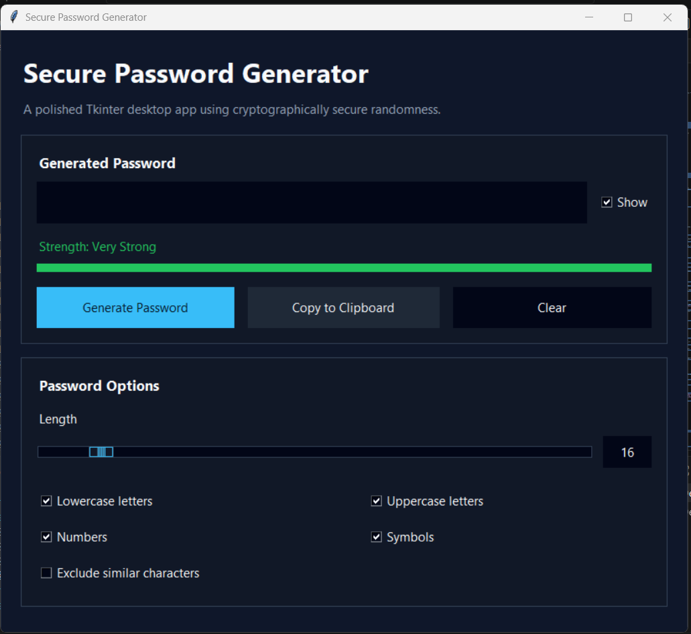

# Secure Password Generator

A polished Python Tkinter desktop application for generating strong passwords with a modern dark interface. The project uses only Python standard-library modules, so it is easy to run, study, and include in a GitHub portfolio.

## Features

- Secure password generation with Python's `secrets` module
- Modern dark Tkinter user interface
- Lowercase, uppercase, number, and symbol options
- Option to exclude similar characters such as `0`, `O`, `l`, and `1`
- Synchronized password length slider and numeric input field
- Password strength indicator: Weak, Medium, Strong, and Very Strong
- Strength scoring based on both length and selected character types
- Guarantees at least one character from every selected character type
- Generate, copy, and clear buttons
- Temporary "Copied successfully" message instead of popups
- Friendly validation and error messages
- Show or hide the generated password
- Session-only history for the latest five generated passwords
- Copy passwords directly from history
- Keyboard shortcuts for faster use
- Responsive layout that prevents widget overlap when resized

## Screenshot

Add a screenshot of the running application here:
## Screenshot


`screenshots/password-generator.png`

## Requirements

- Python 3.10 or newer recommended
- No third-party packages required
- Uses only Python standard-library modules:
  - `tkinter`
  - `secrets`
  - `string`
  - `typing`

## How to Run

1. Clone or download this repository.
2. Open a terminal in the project folder.
3. Run the application:

```bash
python password_generator_ui.py
```

On some systems, use:

```bash
python3 password_generator_ui.py
```

## Keyboard Shortcuts

- `Enter`: Generate password
- `Ctrl+C`: Copy the generated password
- `Esc`: Clear the generated password

## Project Structure

```text
Password-Generator/
|-- password_generator_ui.py
|-- README.md
`-- .gitignore
```

## Security Note

This project uses Python's `secrets` module instead of `random` because `secrets` is designed for generating cryptographically strong random values. The `random` module is useful for simulations and games, but it is not suitable for passwords or security-sensitive tokens.

Passwords are not saved to files, databases, logs, or external services. The history section exists only in memory while the application is open and is cleared when the app closes.

## Future Improvements

- Add an optional passphrase generator
- Add password strength explanations
- Add exportable screenshots for the README
- Add unit tests for password generation logic
- Add light and dark theme switching
